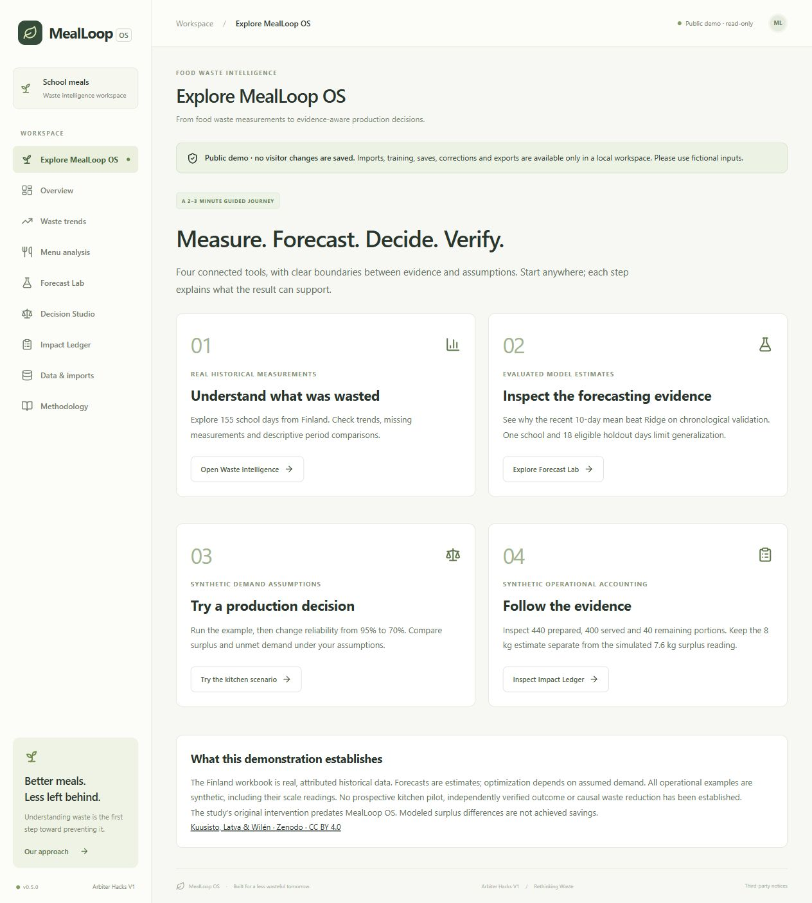

# MealLoop OS

**Food waste decisions with evidence you can inspect.** Built for Arbiter Hacks V1, Theme Track: Rethinking Waste.

School kitchens need to prevent surplus without hiding unmet demand. MealLoop OS connects historical waste measurements, evaluated forecasts, explicit planning assumptions and operational accounting. Each stage shows what its evidence can support. No real kitchen pilot or causal waste reduction has been established.



## Four working modules

| Module | Capability | Evidence |
| --- | --- | --- |
| Waste Intelligence | XLSX/CSV imports, daily and menu trends, totals, missingness and period comparisons | Attributed historical measurements; descriptive comparisons |
| Forecast Lab | Chronological evaluation, three baselines and two Ridge candidates, future waste scenarios | Statistical estimates; the recent 10-day mean won validation |
| Decision Studio | Exact batch-grid planning, service constraints, infeasibility and sensitivity | Conditional on supplied demand scenarios and probabilities |
| Impact Ledger | Portion reconciliation, separate estimates/readings, immutable plans and append-only corrections | Synthetic examples or unverified local operator reports |

React, TypeScript, Vite, Tailwind and Recharts provide the interface. FastAPI serves independent data, forecast, decision and accounting services. Pandas, NumPy and scikit-learn support analysis; SQLAlchemy, SQLite and Alembic provide local persistence. No mandatory API key, paid service, Docker or special hardware is required. [Architecture](docs/ARCHITECTURE.md).

## Install and run locally

Verified environment: **Windows, Python 3.14.0, Node 24.13.1, npm and Git**. Use the exact Python lock for prepared-model compatibility. Linux/cloud execution and other Python versions remain unverified.

```powershell
git clone https://github.com/HIZMALI/MealLoopOS.git
cd MealLoopOS
powershell -NoProfile -ExecutionPolicy Bypass -File .\scripts\setup.ps1 -Run
```

Setup creates a fresh `.venv`, installs the exact Python lock and npm lock, and imports the included official workbook. Later starts use `.\scripts\start.ps1`. Open [the application](http://127.0.0.1:15173/#demo); local API documentation is at [8080/docs](http://127.0.0.1:8080/docs). Ctrl+C stops the combined launcher. Existing listeners are never killed; the launcher reports occupied ports.

Separate-terminal fallback after setup:

```powershell
# Terminal 1, repository root
$env:MEALLOOP_MODE = 'LOCAL'
.\.venv\Scripts\python.exe -m uvicorn app.main:app --app-dir backend --host 127.0.0.1 --port 8080
# Terminal 2, repository root
npm.cmd --prefix frontend run dev
```

Local mode supports imports, explicit model preparation, saved forecasts/plans, operational revisions and exports. Uploads are bounded and validated; missing values remain null. Uploaded filenames never become server paths. Local SQLite data, environment files, uploads, logs and dependencies are excluded from Git. LOCAL has no shared-user authentication: keep it on loopback and never expose it through a public proxy.

## Isolated public-demo mode

The compiled frontend and API share one origin. A separate demo database is created offline from checksum-verified public files. It contains the official historical dataset, a prepared inert JSON predictor, one synthetic plan and two synthetic service examples. Anonymous previews are bounded and never saved. Import, fitting, saving, corrections and export routes are denied server-side; SQLite connections are also read-only. Startup never retrains or reads the normal operational database.

```powershell
npm.cmd --prefix frontend run build
.\.venv\Scripts\python.exe scripts\prepare_public_demo.py
$env:MEALLOOP_MODE = 'PUBLIC_DEMO'
$env:MEALLOOP_PUBLIC_HOSTS = '127.0.0.1'
$env:PORT = '18085' # choose an unused port
Remove-Item Env:MEALLOOP_DATABASE_URL -ErrorAction SilentlyContinue
.\.venv\Scripts\python.exe scripts\serve.py
```

Open [the isolated demonstration](http://127.0.0.1:18085/#demo). Use fictional inputs. Missing demo state is recreated after ephemeral loss; modified or partial state fails closed. `render.yaml` retains a free-service configuration, strict exact Host validation and PUBLIC_DEMO. No hosted URL or completed Render deployment is claimed. [Security boundaries](docs/PUBLIC_DEMO_SECURITY.md) · [Deployment instructions and unverified cloud gates](docs/DEPLOYMENT_GUIDE.md).

## Data and scientific limits

Arja Kuusisto, Jenni Latva and Ella Wilén (2026), *Food waste dataset: secondary school in Finland 2024–2025*, [Zenodo](https://zenodo.org/records/20825233), [DOI 10.5281/zenodo.20825233](https://doi.org/10.5281/zenodo.20825233), [CC BY 4.0](https://creativecommons.org/licenses/by/4.0/).

The unchanged workbook covers **155 school days: 135 baseline and 20 intervention days**. The study's intervention predates this software. Normalization preserves row order, source rows, dates, missingness and conflicts. Redundant gram/kg and per-diner fields are not added as extra mass. If the bundled workbook is unavailable, obtain it from the official record and import it locally; there is no synthetic fallback. [Attribution and reuse](data/README.md) · [Data dictionary](docs/DATA_DICTIONARY.md).

Forecast selection uses baseline validation only. The recent ten eligible observations' mean won; Ridge did not improve the selection metric. Combined validation MAE is **12.55 g/diner over 75 outcomes**; the separate holdout MAE is **8.73 g/diner over 18 eligible outcomes**. Production state and historical evaluation fits are separate. One school and a small holdout do not demonstrate reliable future operational performance. Planned attendance only scales estimated kilograms. [Evaluation](docs/MODEL_EVALUATION.md) · [Forecast protocol](docs/FORECAST_METHODOLOGY.md).

The synthetic planning example recommends **440 portions** at a 95% service target. Its **16 kg modeled surplus difference** is hypothetical, not achieved savings. A 70% target recommends 400, with 12 expected unserved portions. The synthetic ledger keeps an **8 kg portion estimate** separate from a **7.6 kg simulated surplus reading** and **9.7 kg disjoint simulated inventory**. No service or physical weighing occurred. [Decision protocol](docs/DECISION_METHODOLOGY.md) · [Measurement protocol](docs/IMPACT_MEASUREMENT_PROTOCOL.md) · [Evidence limitations](docs/IMPACT_EVIDENCE_LIMITATIONS.md).

Demand, prepared servings and production quantities are never inferred from recorded waste alone. A future prospective evaluation needs consistent scope, preparation/service counts, observed unmet demand, separate waste streams and denominator coverage before any impact claim. Authentication, independently verified operational evidence, PostgreSQL integration, external security/load testing and formal accessibility certification remain future work.

## Verify the release

Run from the repository root with LOCAL mode or `MEALLOOP_MODE` unset:

```powershell
.\.venv\Scripts\python.exe -m pytest
npm.cmd --prefix frontend run typecheck
npm.cmd --prefix frontend run build
.\.venv\Scripts\python.exe scripts\verify_science.py
.\.venv\Scripts\python.exe scripts\prepare_public_demo.py
.\.venv\Scripts\python.exe scripts\release_check.py
.\.venv\Scripts\python.exe scripts\smoke_release.py
.\.venv\Scripts\python.exe scripts\publication_audit.py
```

A failed critical release gate returns **NOT READY** and exits nonzero. The full 398-test suite is retained. [Reproduction details, fingerprints and executed release evidence](docs/REPRODUCIBILITY.md). Generated check reports default to ignored `.run/`; scientific evidence remains in `docs/evaluation/`.

## License and development

Original software is [MIT licensed](LICENSE). The dataset retains CC BY 4.0; dependencies retain their own terms and notices. [Third-party licenses](docs/THIRD_PARTY_LICENSES.md).

Development used AI assistance for code, debugging, review, tests and documentation. An LLM is not the forecasting or optimization engine. Humans remain responsible for assumptions, verification and kitchen practice.

Public history begins with a release snapshot of iterative development.
