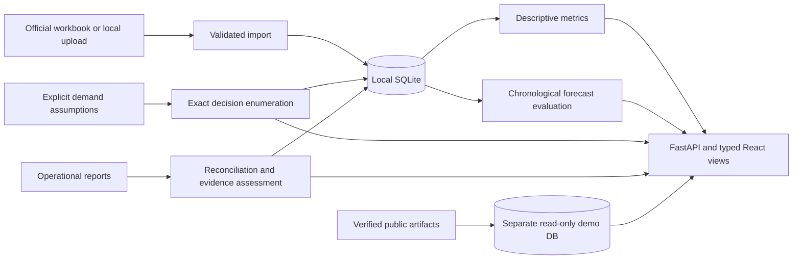

# Architecture

MealLoop OS separates four kinds of evidence: historical measurements, statistical estimates, assumed planning scenarios and operational reports. The corresponding engines are independent; a waste rate is never converted into demand or prepared portions.

## Services and storage

| Component | Responsibility |
| --- | --- |
| `parsing.py`, `importer.py` | Bounded XLSX/CSV inspection, validated normalization, exact-file idempotency and provenance |
| `metrics.py` | Null-aware totals, matched denominators, period/menu/daily series |
| `forecasting.py`, `forecast_service.py` | Strict paired eligibility, chronological selection/evaluation, JSON artifacts and scenarios |
| `decisions.py`, `decision_service.py` | Exact bounded batch grid, explicit constraints, sensitivity and immutable saved plans |
| `impact.py`, `impact_analytics.py`, `impact_service.py` | Portion accounting, evidence separation, append-only revisions and guarded comparisons |
| `config.py`, `public_policy.py`, `security.py`, `demo.py` | Server-owned modes, exact route permissions, resource limits and isolated public state |
| React views | Typed requests, evidence labels, responsive navigation, loading/empty/error states |

SQLAlchemy separates source datasets, immutable import batches, ordered daily records, forecast artifacts/runs, decision plans, operational services and revisions. Alembic migrations **0001–0004** are retained unchanged. LOCAL startup applies migrations; public startup never migrates. SQLite enables foreign keys and a busy timeout. PostgreSQL requires a driver, migration/backup procedure and executed integration checks; it has not been tested.

Imports retain source row numbers and redundant reported fields for audit. Missing observations stay null. Uploaded bytes are discarded after normalization; callers must retain their original files. Source filenames are display metadata, never storage paths. The unchanged official workbook is bundled with attribution.

## Scientific engines

Forecast method selection uses baseline validation only. Earlier observations enter rolling history after their service day; same-day diners are target denominators, never future features. Historical evaluation fits and the final production state remain distinct. Only inert JSON numeric state is persisted; prediction/status requests never fit. Dataset, policy and dependency identities distinguish artifacts. See `FORECAST_METHODOLOGY.md`.

Decision Studio enumerates every permitted batch quantity without silently relaxing constraints or normalizing invalid probabilities. Demand scenarios and portion mass are assumptions. Saved plans preserve their original inputs/results; operational linkage does not reoptimize. See `DECISION_METHODOLOGY.md`.

Impact Ledger keeps synthetic, self-reported and documented self-reported cohorts separate. Corrections append a new revision with server timestamps, version checks and a reason. Finalization requires reconciled known dispositions; incomplete mass coverage stays visible. Portion conversions are separate from readings, and rescued food remains separate from discarded food. These records are not independently verified. See `IMPACT_MEASUREMENT_PROTOCOL.md`.

## Runtime boundaries

LOCAL uses the operator's SQLite database and rejects non-loopback peers. It supports imports, explicit model preparation, saved scenarios, operational revisions and exports. It has no shared-user authentication.

PUBLIC_DEMO reads only server-fixed `.public-demo/demo.db`, using SQLite URI `mode=ro` and `PRAGMA query_only=ON`. Any database override rejects startup. Offline preparation uses only checksum-verified public source/evidence/fixtures and a prepared predictor. Capture/import timestamps used for deterministic seed metadata are explicitly synthetic. Modified/partial demo state is refused; missing state is recreated without contacting the network or reading local operational data.

Every effective API route/method is classified; new or unknown routes receive no public permission. Reference IDs/cohorts, body sizes and computation are bounded. Host/Origin checks, security headers and process-local rate limits apply independently of the UI. Public previews return results without saving them. Full policy and residual limits are in `PUBLIC_DEMO_SECURITY.md`.

`scripts/serve.py` owns one bounded Uvicorn worker and serves compiled React and `/api` from one origin. LOCAL binds loopback 8080; PUBLIC_DEMO binds 0.0.0.0 and validated `PORT`. Only index/favicon/assets are served, with hash navigation. Vite is used for development only. Runtime configuration is fetched before forms mount; failed requests show retry states. Mobile navigation supports Escape/focus restoration and a skip link; formal accessibility conformance is unverified.

`release_check.py` checks dependencies, fingerprints, complete route classification, isolation, readonly behavior, synthetic arithmetic and restart/reseed. `smoke_release.py` launches three real HTTP processes in a disposable allowlisted checkout. `verify_science.py` reproduces the historical evidence in isolated state. These are local checks, not cloud deployment or security certification.
